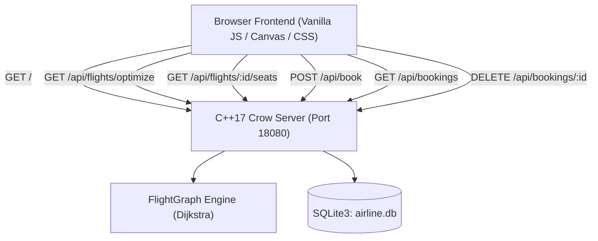

# SkyRoute Neo — Airline Reservation System & Dijkstra Flight Optimizer

[](https://jitesh-ss.github.io/Airline-Rservation-System/)
[](https://github.com/jitesh-ss/Airline-Rservation-System/actions)

SkyRoute Neo is a high-performance airline reservation and routing optimization platform powered by **C++17**, **Crow Microframework**, **SQLite3**, and a state-of-the-art interactive web frontend.

> **Live Web Application**: [https://jitesh-ss.github.io/Airline-Rservation-System/](https://jitesh-ss.github.io/Airline-Rservation-System/)

---

## Key Features

### 1. Dijkstra Shortest Path Flight Optimizer
- Uses graph theory and priority-queue Dijkstra's algorithm to compute the lowest-fare routing between airport hubs (Delhi `DEL`, Mumbai `BOM`, Bengaluru `BLR`).
- Computes multi-hop cost optimizations (e.g., `DEL ➔ BOM ➔ BLR` at ₹7,700 vs direct ₹8,500).
- Displays animated waypoints, flight identifiers, layover details, and carrier schedules.

### 2. Interactive Aircraft Cabin & Seat Selector
- High-fidelity fuselage graphics with cockpit windows, wings, emergency exit rows, and galley partitions.
- Supports multiple aircraft types:
  - **Airbus A320neo** (Air India `AI101` — DEL ➔ BOM)
  - **Airbus A321neo** (IndiGo `6E202` — BOM ➔ BLR)
  - **Boeing 787-9 Dreamliner** (Vistara `UK808` — DEL ➔ BLR)
- Tiered cabin layout: First / Business Class (Rows 1–2) and Standard Economy (Rows 3+).
- Real-time seat status synchronization with SQLite database (`airline.db`).
- Atomic collision prevention: handles simultaneous seat reservation conflicts with HTTP 409 and user feedback.

### 3. Digital Boarding Pass Generator
- Generates realistic airline boarding passes with passenger name, PNR code, seat number, gate, terminal, and boarding times.
- Dynamically rendered SVG barcodes and security QR codes.
- Integrated Print / Save as PDF capability.

### 4. Live Air Traffic Radar Simulator
- HTML5 Canvas radar screen with range rings, rotating scanner beam, and airport hubs.
- Animated aircraft navigating active routes in real-time.
- Visual Dijkstra route highlighter displaying winning paths.

### 5. Persistent Reservations Manager
- SQLite-backed bookings ledger with instant ticket retrieval.
- One-click booking cancellation that automatically frees up occupied seats in real time.

### 6. Acoustic & Visual Polish
- Native Web Audio API sound synthesizer (boarding chimes, seat clicks, conflict buzzes).
- Dynamic canvas confetti bursts on confirmed reservations.
- Real-time server telemetry heartbeat monitoring latency to the Crow C++ engine.

---

## System Architecture



---

## REST API Specification

| Method | Endpoint | Description |
|---|---|---|
| `GET` | `/` | Serves the single-page frontend application (`public/index.html`) |
| `GET` | `/api/health` | Health check endpoint returning `{ "status": "running" }` |
| `GET` | `/api/flights` | Returns catalog of all scheduled flights and aircraft metadata |
| `GET` | `/api/flights/optimize?from=DEL&to=BLR` | Computes Dijkstra shortest path and lowest total cost |
| `GET` | `/api/flights/:flight_id/seats` | Returns list of currently occupied seats for a flight |
| `POST` | `/api/book` | Books a seat for a passenger with SQLite collision handling |
| `GET` | `/api/bookings` | Lists all confirmed reservations stored in `airline.db` |
| `DELETE` | `/api/bookings/:id` | Cancels a booking and releases the seat |

---

## 🚀 Running the Live Website

### Option 1: Live Online (GitHub Pages / Vercel)
The project is configured for automated zero-config deployment:
- **GitHub Pages**: Push to `main` branch. The automated workflow in [`.github/workflows/deploy.yml`](file:///.github/workflows/deploy.yml) automatically deploys to:
  `https://jitesh-ss.github.io/Airline-Rservation-System/`
- **Vercel / Netlify**: Run `npx vercel` or import this repository on Vercel.

### Option 2: Instant Local Web Server (Node.js)
```bash
npm start
# Opens interactive web app at http://localhost:3000/
```

### Option 3: Full C++17 Crow + SQLite Backend
```bash
# 1. Configure and compile with CMake
cmake -B build -G "MinGW Makefiles"
cmake --build build

# 2. Run the C++ Crow server (Port 18080)
# Windows
.\build\airline_server.exe

# Linux / macOS
./build/airline_server
```

Open your browser at:
```
http://localhost:18080/
```

---

## 👤 Authors

- **Jitesh.M**
- **Shashanka.B**

---

## 📄 License

This project is open-source and available under the [MIT License](LICENSE).